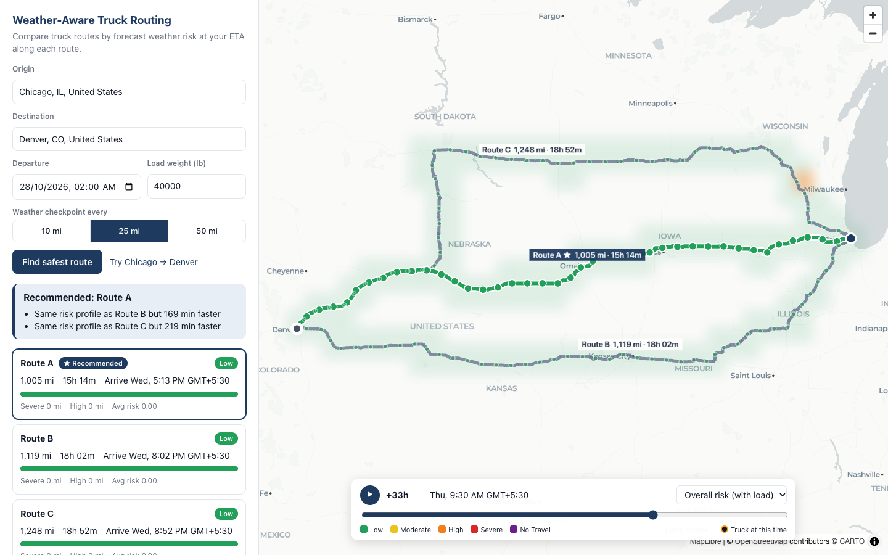

# Weather-Aware Truck Routing

A React + Django app that helps a truck driver pick the safest route. It compares up to three
truck routes using the forecast weather at the moment the truck reaches each point, the
truck's load weight, and travel time.

**Live demo:** _add the Vercel URL here_ · **Walkthrough:** _add the Loom link here_



## What it does

1. Enter an origin and destination (with autocomplete), a departure time, the load weight, and a
   checkpoint spacing of 10, 25 or 50 miles.
2. The backend fetches **3 truck-specific routes** from HERE, places a checkpoint every N miles on
   each, and works out the **ETA at every checkpoint** using HERE's travel time for each stretch
   of road.
3. For each checkpoint it looks up the hourly forecast **for that ETA**, classifies the risk with the
   wind, rain, snow and load rules, and adds up the miles at each risk level per route.
4. It recommends a route using the required order of preference and explains the choice
   ("0 Severe mi vs 42 on Route B").
5. The map shows every route, the selected route coloured by risk, every checkpoint (hover for ETA,
   weather, risk and the reasons behind it), route labels, and a **0–48 h weather heatmap** over the
   trip corridor. The heatmap has a smooth time slider and play button, and truck markers show where
   each truck would be at the selected time.

## Architecture

```
React (Vite, TS) ──/api──▶ Django + DRF ──▶ HERE Routing v8 (truck) · HERE Geocoding
  MapLibre + deck.gl                     └─▶ Open-Meteo hourly forecast
```

```
backend/planner/
  domain/        pure logic, no I/O; most of the tests are here
    risk.py        thresholds + load rules → level and reasons
    sampling.py    checkpoints every N mi, ETA interpolated from per-vertex travel time
    scoring.py     risk miles per route + lexicographic recommendation
    corridor.py    regular grid of cells inside a 30-mile buffer around the routes
  providers/     external APIs: one adapter each, returning provider-independent types
    routing.py     HERE truck routing → NormalizedRoute; adds alternatives when HERE returns < 3
    weather.py     batched, cached Open-Meteo client; picks weather for a given ETA
    geocoding.py   HERE geocoding (US and Canada)
  services/      orchestration (plan.py, heatmap.py)
  api/           DRF validation, serialization, views
frontend/src/
  map/           MapView (deck.gl layers), heatmap raster rendering, MapLibre worker setup
  components/    TripForm, LocationInput, RouteList, CheckpointTable, ForecastControls
  lib/           risk colours and scales, formatting, position-along-route helpers
```

The `domain` layer has no knowledge of HERE, Open-Meteo or Django. Providers convert API responses
into plain dataclasses (`NormalizedRoute`, `Weather`), so either provider could be swapped without
touching the risk or recommendation logic.

## How the core logic works

### Routes
- HERE Routing v8 with `transportMode=truck`, `vehicle[grossWeight]` (from the load) and
  `alternatives=2`.
- ETA accuracy: `spans=dynamicSpeedInfo,length,duration` splits each route wherever the expected
  speed changes (about 700 pieces on Chicago → Denver). Each piece's duration is spread across its
  polyline points by distance, so checkpoint ETAs reflect highway versus city speeds instead of one
  average speed.
- HERE often returns fewer than 3 routes, especially on short trips. In that case the backend
  routes again through **via points offset to either side** of the trip's midpoint. It drops any
  candidate that shares more than 80% of its length with an existing route or takes more than 1.6×
  as long as the fastest. If no candidate passes, fewer than 3 routes are shown rather than
  near-duplicates.

### Checkpoints and weather
- Checkpoints sit at 0, N, 2N … miles plus the destination. A final stretch shorter than 1% of N is
  merged into the destination checkpoint.
- One Open-Meteo request covers every checkpoint on every route, in batches of 100 locations.
  Coordinates are rounded to 0.05° so nearby points share a forecast, and results are cached for
  30 minutes.
- **Choosing the hour for an ETA:** wind is a point-in-time value, so it is interpolated
  linearly between the two surrounding hours. Rain, showers and snowfall are Open-Meteo totals for
  the *previous* hour, so the hour **ending** at or after the ETA is used. Hourly totals are
  already in in/hr.
- An ETA beyond the forecast range gives a checkpoint with no forecast. The UI shows it as unknown,
  and its miles are reported separately rather than guessed.

### Risk rules (`backend/planner/domain/risk.py`)

| Condition | Low | Moderate | High | Severe | No Travel |
|---|---|---|---|---|---|
| Wind (mph) | < 25 | 25 – < 35 | 35 – < 45 | 45 – < 55 | ≥ 55 |
| Rain (in/hr) | < 0.10 | 0.10 – < 0.25 | 0.25 – < 0.50 | 0.50 – 1.00 | > 1.00 |
| Snow (in/hr) | < 0.5 | 0.5 – < 1.0 | 1.0 – < 2.0 | 2.0 – 3.0 | > 3.0 |

- Checkpoint risk is the **worst** of the wind, rain and snow levels.
- **Load rules** can then raise the level:
  - wind ≥ 55 mph → No Travel for any load
  - wind 45–54 mph and load > 30,000 lb → No Travel
  - wind 35–44 mph and load > 40,000 lb → at least Severe
- Each checkpoint returns the reasons behind its level, e.g. "Wind 47 mph with 36,000 lb load".

### Recommendation (`backend/planner/domain/scoring.py`)
- The stretch between two checkpoints takes the **worse** of their two risk levels, so every mile is
  counted exactly once.
- Routes are compared in this order:
  1. contains any **No Travel** miles (such routes always rank last)
  2. fewest **Severe** miles
  3. fewest **High** miles
  4. lowest **average risk**, weighted by distance (Low = 0 … No Travel = 4)
  5. shortest **travel time**
- Mileage is rounded to 0.1 mi before comparing, so floating-point noise can't swap two routes that
  are genuinely tied.
- The explanation names the first of these criteria that separates the recommended route from each
  other route. If every route has No Travel miles, the app recommends the least bad one and warns
  the driver to consider delaying.

### Heatmap
- The backend builds a regular latitude/longitude grid over a **30-mile buffer** around all routes.
  Cell size grows with trip length to keep about 250 cells, and cells line up with the weather
  lookup grid.
- One request returns **all 49 hours** (0–48) of overall risk (including load), wind, rain and
  snow: about 15 KB gzipped. The slider never fetches anything.
- The frontend draws each hour as a small image (one pixel per cell), smooths it with bilinear
  upscaling, and places it on the map with deck.gl's `BitmapLayer`. The result stays accurate at
  every zoom level, unlike a density heatmap whose blur radius is fixed in screen pixels.
- The slider moves in **fractional hours** and cross-fades the two neighbouring frames. Truck
  markers move continuously along the real road geometry, and Play runs on `requestAnimationFrame`.
- **Measured** in the production build on an Apple M1 with Chromium: 60 fps while scrubbing
  (median frame 16.7 ms, worst 18.6 ms), with about 1 ms of JavaScript per slider step.

## Assumptions and interpretation

- **Band boundaries:** each band includes its lower bound and excludes its upper one. The spec
  writes the top rain and snow bands with ">", so exactly 1.00 in/hr of rain is Severe and anything
  above is No Travel. Wind uses "≥ 55" as written.
- **Wind:** classification uses **sustained** wind (`wind_speed_10m`). Gusts are shown but not
  used, because the rules give a single wind speed.
- **Rain** = Open-Meteo `rain + showers`. **Snow** = `snowfall`.
- **Driving time:** ETAs assume continuous driving at HERE's predicted speeds. Hours-of-service
  rest breaks are not modelled.
- **Departure** must be within the next 7 days, since forecast quality drops off after that.
  Weather is fetched for 14 days, so long trips still get a forecast for their later checkpoints.
- **Time zones:** times are entered and shown in the browser's time zone and sent to the API as
  absolute UTC times.
- **Slider:** hours count from **now**, the start of the forecast, not from the departure time.
- **Coverage:** search is limited to the US and Canada, because the rules use US units.

## API

| Method | Path | Body / query | Returns |
|---|---|---|---|
| GET | `/api/geocode?q=` | free-text query | `{results: [{label, lat, lon}]}` |
| POST | `/api/plan` | `{origin, destination, departure, load_lb, interval_mi}` | routes (geometry `[lon, lat, elapsed_s]`), checkpoints (ETA, weather, risk and reasons), per-route summaries, recommendation and reasons, bounds |
| POST | `/api/heatmap` | `{lines, load_lb}` | grid definition plus `risk / wind / rain / snow[hour][cell]` for hours 0–48 |

Error responses:
- invalid input → `400` with the error for each field
- no truck route between the points → `422`
- HERE or Open-Meteo failure → `502`

Requests are rate-limited per IP (`PLAN_RATE`, default 60/hour) to protect the free-tier quotas.

## Running locally

Requirements: Python 3.12+, Node 20+, and a [HERE API key](https://platform.here.com/) (the free
Base plan includes 5,000 truck-routing requests a month; a payment method must be on file).
Open-Meteo needs no key.

```bash
# Backend
cd backend
python -m venv .venv && source .venv/bin/activate
pip install -r requirements-dev.txt
cp .env.example .env            # then set HERE_API_KEY
DJANGO_DEBUG=1 python manage.py runserver

# Frontend (second terminal), proxies /api to :8000
cd frontend
npm install
npm run dev                     # http://localhost:5173
```

### Tests

```bash
cd backend && pytest            # 73 tests: risk boundaries, load rules, sampling/ETA, ranking,
                                # HERE parsing (recorded response), weather hour selection, corridor grid, API
cd frontend && npm run lint && npm run build
```

## Deployment

The app is hosted on **Vercel's free Hobby plan**, so nothing sleeps:
- The built React app is served from Vercel's CDN.
- `/api/*` is rewritten to one Python function ([api/index.py](api/index.py)) that runs the Django
  app.
- After an idle period, the first API call takes about a second to start, compared with 30–60 s for
  a sleeping container.

Configuration lives in [vercel.json](vercel.json). The root `requirements.txt` holds the function's
runtime dependencies, and `.vercelignore` keeps `.env`, virtual environments and tests out of the
upload.

```bash
vercel link --project truck-routing
vercel env add HERE_API_KEY production
vercel env add DJANGO_SECRET_KEY production
vercel deploy --prod
```

Environment variables:

| Variable | Purpose |
|---|---|
| `HERE_API_KEY` | required |
| `DJANGO_SECRET_KEY` | any long random string |
| `PLAN_RATE` | throttle for plan and heatmap requests, default `60/hour` |

**Alternative: a single container.** The root `Dockerfile` builds the React app into the Django
image. WhiteNoise serves the frontend at `/` and gunicorn serves the API on the same origin. This
runs on any container host (Cloud Run, Fly.io, a VM).

## Limitations and next steps

- **Cache:** the cache (forecasts and rate-limit counters) is in memory, per function instance.
  A shared store such as Redis or Vercel KV would share hits across instances and enforce a global
  rate limit.
- **Quotas:** the Open-Meteo free tier counts each location as one call (10,000 a day). A trip
  costs about 100–150 calls for checkpoints and about 250 for the heatmap, before caching.
- **Rest breaks:** hours-of-service modelling would make ETAs on trips longer than about 11 hours
  more realistic.
- **Alternatives:** the via-point routes are reasonable but not guaranteed to be the second- and
  third-best routes. A routing engine with native k-alternatives would do better.
